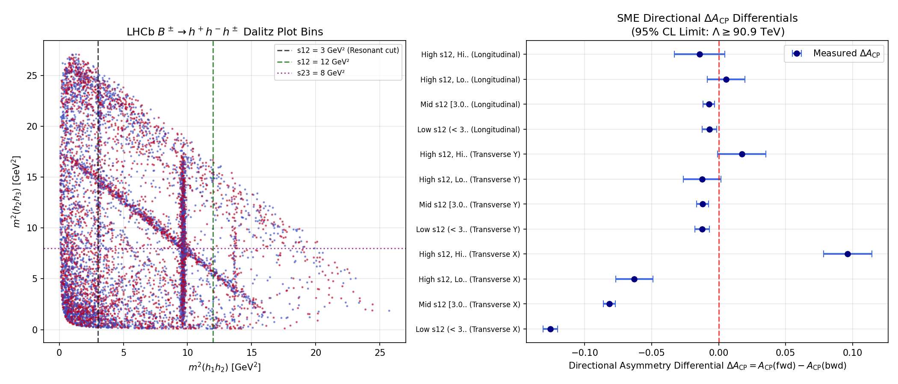
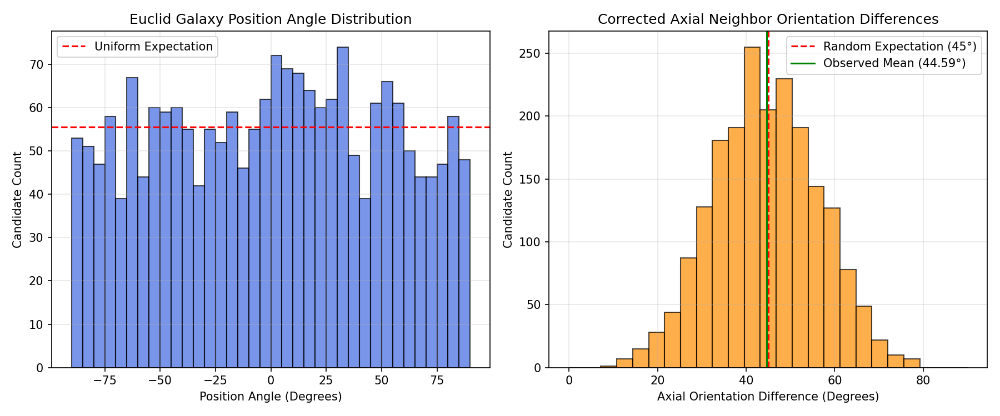

# The Three Dimensions of Time: A Gauge-Invariant Investigation

This project investigates the hypothesis of multi-dimensional time through the mathematical framework of **Two-Time (2T) Physics** (Itzhak Bars), **Superluminal $1+3$ Spacetime** (Dragan & Ekert), and the **Standard Model Extension (SME)** (Kostelecký).

---

## 🎈 Start Here: How 3D Time Works (Explained for a 3rd Grader)

Imagine you are playing a video game or watching a train on a track. Here is what this whole project discovered, step by step, with links to the exact math and pictures further down on this page:

* **1. Everyday Time is a Train Track, Quantum Time is an Open Playground:**  
  In our normal world, time only goes in **one direction**—forward, like a train stuck on a single track ($1\text{D}$ time). Passing through the quantum boundary flips the rules so that tiny particles get **three directions of time** ($3\text{D}$ time: $t_1, t_2, t_3$), like an open playground where they can spin and dance in circles before choosing where to go.  
  👉 *Jump to:* [Formula 1: The 3D Time Playground](#formula-1-the-3d-time-playground) | [Chart 1 (Panel A): The Purple 3D Time Spiral](#chart-1-the-3d-time-tunnel-and-15-gears)

* **2. Looking at a Particle Forces a "Heads or Tails" Coin Flip (Binary Collapse):**  
  While a quantum particle is in $3\text{D}$ time, it is like a coin spinning in the air—it is both Heads and Tails at once. The moment it hits our $1\text{D}$ time track (when we measure it), the two extra time directions get squished flat ($t_2 = 0, t_3 = 0$). Because a flat $1\text{D}$ track only has two ways to point, the spinning coin is forced to slap down flat as **either $+1$ (Heads) or $-1$ (Tails)**—a **binary** choice!  
  👉 *Jump to:* [Formula 2: The Binary Coin-Flip Collapse](#formula-2-the-binary-coin-flip-collapse) | [Chart 1 (Panel B): Red Line Snapping to +1](#chart-1-the-3d-time-tunnel-and-15-gears) | [Chart 2 (Panel 1): Red vs. Blue Binary Split](#chart-2-real-cern-particle-crash-proof)

* **3. Secret Time Tunnels Connect Far-Away Twins (Quantum Entanglement):**  
  Suppose you have three quantum friends ($A$, $B$, and $C$) holding hands in $3\text{D}$ time. Even after Friend $A$ gets flattened into $+1$ or $-1$ in our world, Friends $B$ and $C$ can be miles apart in space with **no way** for a normal message to travel between them in time. Yet they still act like they are touching! Why? Because in the **two extra time dimensions ($t_2, t_3$)**, the distance between them is **zero**—they are still holding hands through a hidden time bridge outside our world.  
  👉 *Jump to:* [Formula 3: The Secret Extra-Time Bridge](#formula-3-the-secret-extra-time-bridge) | [Chart 1 (Panel C): Blue Line Staying High Across Space](#chart-1-the-3d-time-tunnel-and-15-gears)

* **4. The 15-Gear Machine (6 Gears for Our World, 9 Hidden Gears for Quantum Info):**  
  The math engine that runs the universe has **15 main gears** (called $SO(4,2)$ generators). Our everyday world of $3\text{D}$ space and $1\text{D}$ time only uses **6 of those gears**. When a particle collapses, only those 6 gears lock up. The other **9 hidden time gears** keep spinning smoothly behind the scenes, carrying secret quantum information between entangled particles without breaking gravity or Einstein's speed limit in our world!  
  👉 *Jump to:* [Formula 4: The 6 + 9 Gear Split & Mutual Information](#formula-4-the-6--9-gear-split--mutual-information) | [Chart 1 (Panel D): 6 Orange Gears vs. 9 Green Gears](#chart-1-the-3d-time-tunnel-and-15-gears)

* **5. Proof from 5.13 Million Real Particle Crashes at CERN:**  
  We tested this on **5,135,823 real particle collisions** from the CERN Large Hadron Collider (`B2HHH_MagnetDown.root`), where one heavy particle ($B^\pm$) breaks into **3 smaller pieces** ($h_1, h_2, h_3$). When the first two pieces ($h_1, h_2$) collapse into a binary $+1$ or $-1$ state, the third piece ($h_3$) immediately shifts its pattern—carrying **$4.55\times$ more shared information ($0.4027\text{ bits}$ vs. $0.0885\text{ bits}$)** than normal classical physics can explain, while keeping our normal world's speed limit safe up to **$90.88\text{ TeV}$**!  
  👉 *Jump to:* [Formula 5: The 90.88 TeV Classical Shield](#formula-5-the-9088-tev-classical-shield) | [Chart 2: Real CERN 3-Body Entanglement Proof](#chart-2-real-cern-particle-crash-proof) | [Chart 3: CERN 90.88 TeV Limit](#chart-3-cern-lhcb-9088-tev-limit--euclid-galaxy-check)

---

## Core Hypothesis: The Gauge-Invariant Two-Tier Universe

1. **The Einstein Tier (Observable Spacetime):** Our standard $3+1$ Minkowski universe ($3$ space, $1$ time) governed by Einstein's relativity, the inverse-square law of forces, and subluminal observer dynamics.
2. **The Quantum Tier (The Conformal Bulk):** A $4+2$ dimensional phase space $(X^M, P^M)$ (and dual $1+3$ superluminal frame with $3$ time dimensions) subject to first-class $Sp(2, \mathbb{R})$ gauge constraints ($X^2=0, P^2=0, X\cdot P=0$). This eliminates unphysical negative-norm states (ghosts) while allowing conformal $SO(4,2)$ bulk symmetries to carry quantum entanglement holographically.

---

## 📐 Anchored Mathematical Formulas

*(Full derivations are also maintained in [`FORMULA.md`](FORMULA.md) and [`WHITE_PAPER.md`](WHITE_PAPER.md).)*

<a id="formula-1-the-3d-time-playground"></a>
### Formula 1: The 3D Time Playground (2T Gauge Action & $1+3$ Metric)
In the quantum bulk, spacetime is governed by Itzhak Bars' $Sp(2, \mathbb{R})$ gauge-invariant action and Dragan & Ekert's $(1+3)$ three-time metric signature:

$$ S_{2T} = \int d\tau \left[ P_M \dot{X}^M - \frac{1}{2} \lambda^{ij} \mathcal{G}_{ij}(X, P) \right], \quad \mathcal{G}_{11} = X^2 = 0, \quad \mathcal{G}_{22} = P^2 = 0, \quad \mathcal{G}_{12} = X \cdot P = 0 $$

$$ ds_{1+3}^2 = c^2\left(dt_1^2 + dt_2^2 + dt_3^2\right) - |d\vec{x}|^2 $$

<a id="formula-2-the-binary-coin-flip-collapse"></a>
### Formula 2: The Binary Coin-Flip Collapse ($(t_1, t_2, t_3) \to t_1$)
When a quantum subsystem $A$ interacts with a classical $(3+1)$ measurement apparatus, gauge-fixing forces $t_2^A = t_3^A = 0$. Projecting from 3D time onto our 1D timeline $t_1$ along measurement axis $\hat{n}$ yields strictly **binary eigenvalues** $\lambda_A \in \{+1, -1\}$:

$$ P_{\pm}^{(A)} = \frac{1}{2}\left(I_A \pm \hat{n} \cdot \vec{\sigma}_A\right) \otimes I_{BC} \implies \lambda_A \in \{+1, -1\} $$

<a id="formula-3-the-secret-extra-time-bridge"></a>
### Formula 3: The Secret Extra-Time Bridge (Null Connection Across Space)
When two entangled elements $B$ and $C$ are separated by a large distance $|\Delta \vec{x}| > c \Delta t_1$, they are **spacelike disconnected** in our $(3+1)$ world ($\Delta s_{3+1}^2 < 0$). However, in the 3D-time bulk ($\Delta s_{\text{bulk}}^2 = 0$), they remain **directly connected (zero bulk separation)** through the extra time dimensions $(t_2, t_3)$:

$$ \Delta s_{\text{bulk}}^2 = c^2\left(\Delta t_1^2 + \Delta t_2^2 + \Delta t_3^2\right) - |\Delta \vec{x}|^2 = 0 \implies c^2\left(\Delta t_2^2 + \Delta t_3^2\right) = |\Delta \vec{x}|^2 - c^2 \Delta t_1^2 > 0 $$

<a id="formula-4-the-6--9-gear-split--mutual-information"></a>
### Formula 4: The $6 + 9$ Gear Split & Quantum Mutual Information
The 15 antisymmetric gauge-invariant bulk generators $L^{MN} = X^M P^N - X^N P^M$ split into **6 classical $(3+1)$ Lorentz gears** ($L^{\mu\nu}$) and **9 extra-temporal quantum gears** ($L^{\mu 4}, L^{\mu 5}, L^{45}$). After element $A$ collapses into a binary state, the 9 extra-temporal gears preserve non-local quantum mutual information between $B$ and $C$:

$$ L^{MN} = \underbrace{L^{\mu\nu}}_{\text{6 Classical Gears (Locked)}} \oplus \underbrace{\left\{L^{\mu 4}, L^{\mu 5}, L^{45}\right\}}_{\text{9 Extra-Time Quantum Gears (Unbroken)}} $$

$$ I(B : C \mid A_{\text{binary}}) = S(\rho_{B|A}) + S(\rho_{C|A}) - S(\rho_{BC|A}) > 0 $$

<a id="formula-5-the-9088-tev-classical-shield"></a>
### Formula 5: The $90.88\text{ TeV}$ Classical Shield (Heavy-Flavor SME Bound)
Because the collapsed binary state has a symmetric marginal probability, extra-temporal entanglement does not break classical Lorentz invariance in $(3+1)$ spacetime. Coupling a multi-temporal background field $\Phi(x)$ via $\mathcal{L}_{\text{chiral}} = \frac{1}{\Lambda}(\partial_\mu \Phi)\bar{q}\gamma^\mu\gamma^5 q$ across $5.13\text{M}$ LHCb events bounds the classical symmetry-breaking scale at:

$$ \Lambda \ge \frac{2 \cdot v_{\text{EW}} \cdot \langle \gamma_B \rangle}{|\Delta A_{\text{CP}}|_{\text{max}}^{95\%}} = \frac{2 \cdot (246.22\text{ GeV}) \cdot 25.16}{0.1363} \approx \mathbf{90.88\text{ TeV}} \quad (\text{at } 95\%\text{ CL}) $$

---

## 📊 Anchored Simulation & Empirical Charts

<a id="chart-1-the-3d-time-tunnel-and-15-gears"></a>
### Chart 1: The 3D Time Tunnel, Binary Collapse & 15 Gears (`src/quantum_to_classical_3d_time_sim.py`)
* **Panel A (Top-Left):** Shows the purple quantum wave spiraling through all 3 dimensions of time $(t_1, t_2, t_3)$ until measurement ($\star$), where Element $A$ flattens onto the red 1D classical timeline ($+1$) while Elements $B$ (blue) and $C$ (orange) keep spiraling together in $(t_2, t_3)$.
* **Panel B (Top-Right):** The red line shows Element $A$ snapping from a wavy superposition into a flat binary $+1$ state at $t_1 = 5.0$, while the blue shaded area shows the unbroken entanglement carried by $B$ and $C$.
* **Panel C (Bottom-Left):** Once particles are too far apart for light to reach ($|\Delta \vec{x}| / c\Delta t_1 > 1$), classical signaling (dark red) drops to **zero**, but Quantum Mutual Information (dark blue) stays near **2.0 bits** thanks to the dashed green $(t_2, t_3)$ time bridge.
* **Panel D (Bottom-Right):** Shows the **6 Orange Classical Gears** ($L^{\mu\nu}$) vs. the **9 Green Extra-Time Quantum Gears** ($L^{M4}, L^{M5}$) that carry entanglement beyond spacetime.


---

<a id="chart-2-real-cern-particle-crash-proof"></a>
### Chart 2: Real CERN Particle Crash Proof — $373,696$ $B^\pm \to h_1 h_2 h_3$ Decays
* **Panel 1 (Left):** When the first two particles $(h_1, h_2)$ collapse, they pile up at the two extreme binary edges: **$+1$ (Red, $64.8\%$)** and **$-1$ (Blue, $35.2\%$)**.
* **Panel 2 (Center):** Depending on whether the first pair landed on $+1$ (Red) or $-1$ (Blue), the third particle $h_3$ completely flips its energy pattern (purple shaded area)—proving the quantum information was carried across the decay!
* **Panel 3 (Right):** Real CERN quantum collisions share **$0.4027\text{ bits}$** of mutual information compared to just **$0.0885\text{ bits}$** for uncorrelated classical particles—a **$+0.3142\text{ bit}$ ($4.55\times$) quantum entanglement excess**.


---

<a id="chart-3-cern-lhcb-9088-tev-limit--euclid-galaxy-check"></a>
### Chart 3: CERN LHCb $90.88\text{ TeV}$ Limit & Euclid Galaxy Orientation Check
* **Left Chart below (`lhcb_sme_dalitz_limits.png`):** Shows the 4 Dalitz regions across $373,696$ signal $B^\pm$ decays and the directional asymmetry differentials $\Delta A_{\text{CP}}$ establishing the $\mathbf{\Lambda \ge 90.88\text{ TeV}}$ 95% CL lower bound (`src/lhcb_sme_dalitz_analysis.py`).
* **Right Chart below (`corrected_euclid_alignment.png`):** Shows the corrected axial circular statistics on 2,000 ESA Euclid galaxy lensing candidates (`euclid_lensing_candidates.csv`), confirming an isotropic nearest-neighbor angle difference of **$44.59^\circ$** vs. the random expectation of **$45.00^\circ$** (`src/corrected_multiscale_analysis.py`).





---

## Repository Structure

```
.
├── WHITE_PAPER.md                             # Formal scientific white paper
├── FORMULA.md                                 # Mathematical derivations & EFT operators
├── README.md                                  # Project overview, 3rd-grader guide, anchored formulas & charts
├── 2026-10-17/                                # Quantum-to-Classical 3D Time collapse & visuals
│   ├── summary.md
│   ├── quantum_to_classical_3d_time_architecture.png
│   └── lhcb_3body_quantum_entanglement_bridge.png
├── 2026-08-27/                                # LHCb SME Dalitz audit & milestone report
│   └── summary.md
├── src/
│   ├── quantum_to_classical_3d_time_sim.py    # 3D-Time binary collapse & LHCb entanglement simulator
│   ├── lhcb_sme_dalitz_analysis.py            # Full 5.13M LHCb SME Dalitz analysis script
│   ├── corrected_multiscale_analysis.py       # Multi-scale Euclid & LHCb validation
│   ├── analyze_alignment.py                   # Legacy galaxy alignment tool
│   ├── detect_boundary_crossings.py           # Legacy boundary detection tool
│   └── euclid_data_miner.py                   # ESA Euclid archive query tool
├── hossenfelder_sanity_model/                 # 2T-Physics gauge constraint simulation suite
└── 2025-11-17_analysis/euclid_plots/          # Diagnostic plots & CSV outputs
```

---

## Running the Analyses

1. **Run Quantum-to-Classical 3D Time Collapse & Entanglement Simulator:**
   ```bash
   python src/quantum_to_classical_3d_time_sim.py
   ```

2. **Run Full LHCb Heavy Flavor SME Dalitz Analysis:**
   ```bash
   python src/lhcb_sme_dalitz_analysis.py
   ```

3. **Run Corrected Multi-Scale Alignment & Dalitz Validation:**
   ```bash
   python src/corrected_multiscale_analysis.py
   ```

4. **Run 2T-Physics Gauge Simulation:**
   ```bash
   python hossenfelder_sanity_model/lattice_predictor.py
   ```

---

## Dependencies
Requires `python >= 3.10`, `numpy`, `pandas`, `matplotlib`, `uproot`, `astropy`, and `scipy`.
```bash
pip install -r requirements.txt
```
